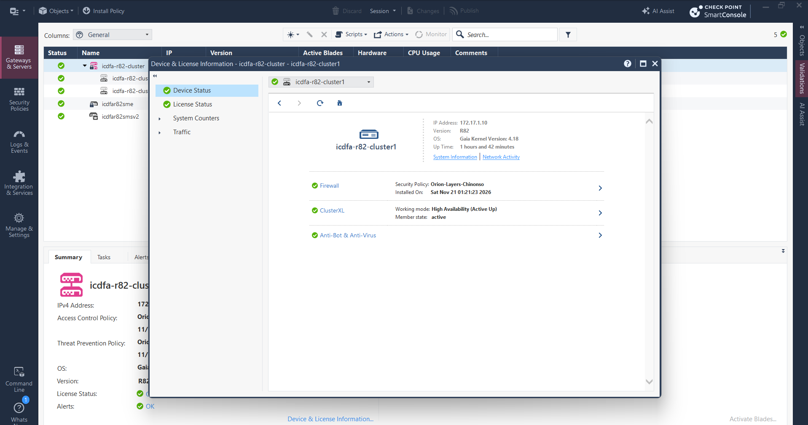
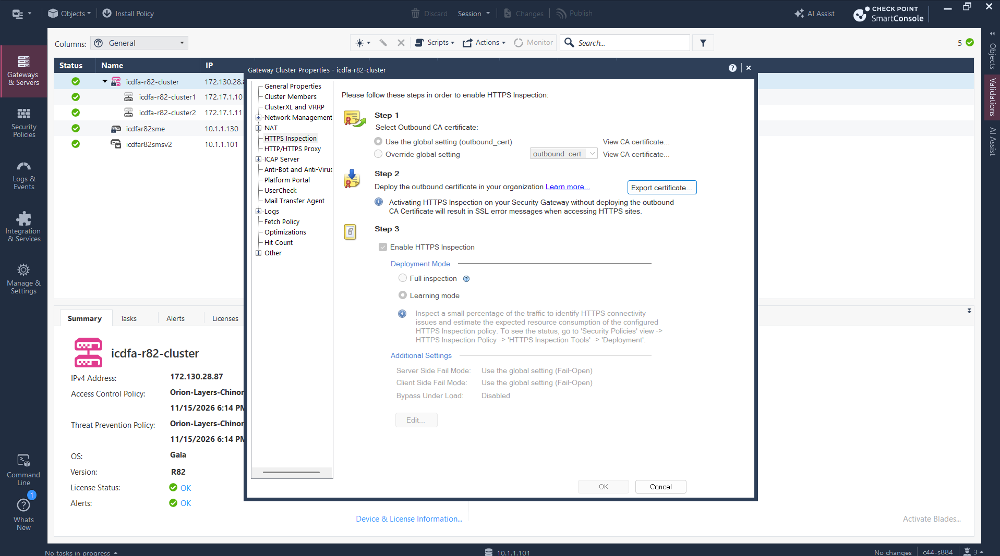
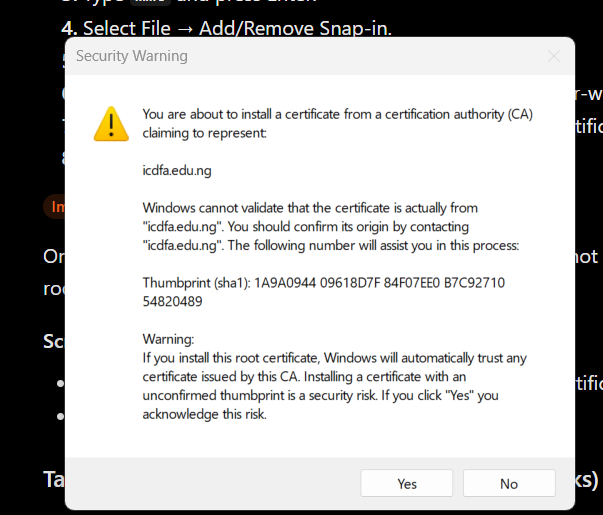
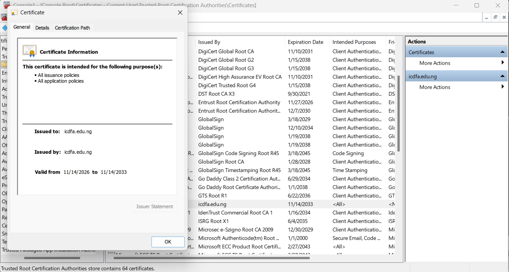
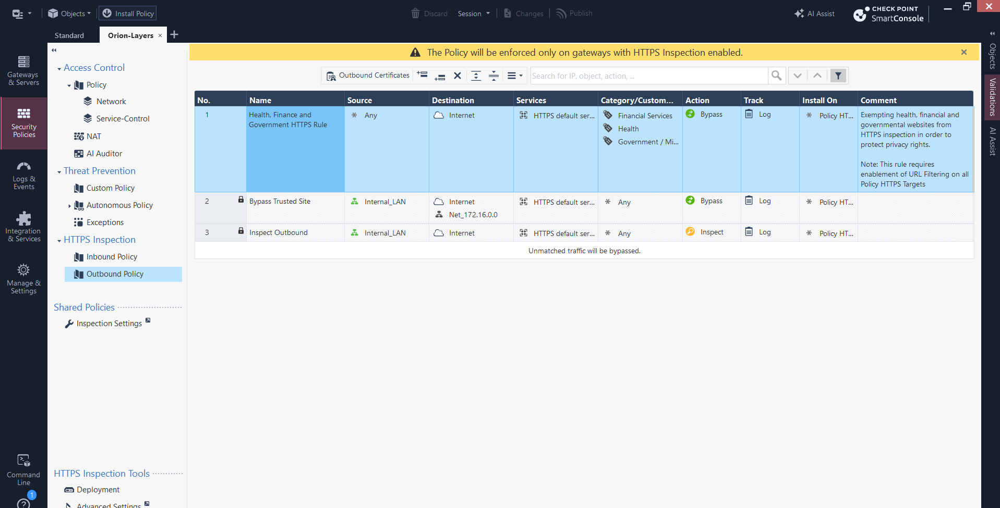
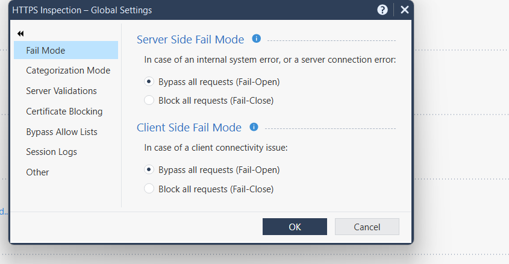
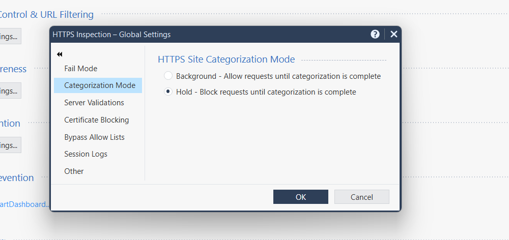
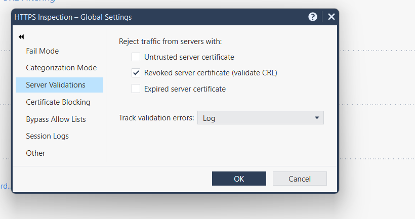

# CCSA108 Practical Assignment Report
## HTTPS Inspection — Check Point R82

| Student information | Details |
|---|---|
| Student Name | Mukaram Oladega |
| Student ID | C11/26/CCSA/17114 |
| Course | CCSA108 – HTTPS Inspection |
| Practical environment | Check Point Cloud / Remote Lab |
| Gateway version | R82 |
| Submission date | 21 November 2026 |

## 1. Introduction

This report documents the practical work for the CCSA108 Module 8 assignment on HTTPS Inspection. The exercise covers the purpose and operation of HTTPS Inspection, gateway configuration, outbound certificate authority (CA) deployment, outbound inspection policy rules, and the relevant global settings in Check Point SmartConsole.

The practical work was completed in a Check Point Cloud / remote lab using a Security Gateway running R82. The report records the configuration details visible in the supplied screenshots and explains the security purpose of each configuration area.

## 2. Lab environment and scope

The practical environment was the Check Point Cloud / remote lab. The gateway details screenshot identifies the gateway object as `icdfa-r82-cluster1` and shows version **R82**. The gateway configuration was managed through SmartConsole.

The scope of this report is the HTTPS Inspection configuration and policy-management work represented in the supplied evidence: gateway/version identification, HTTPS Inspection enablement and deployment mode, outbound CA selection and client trust-store evidence, outbound policy rule configuration, and Global Settings.

## 3. Practical work

### 3.1 Task 1 – Identify the gateway version and review release information

The gateway details were opened in SmartConsole. The supplied gateway screenshot identifies the environment as Check Point R82 and shows the gateway object name `icdfa-r82-cluster1`.

**Figure 1.** Gateway details showing the R82 software version.

The gateway version is recorded as R82. Release-specific prerequisites and compatibility should be checked against the official R82 Release Notes applicable to the exact gateway build before production deployment.

### 3.2 Task 2 – Enable HTTPS Inspection and configure the outbound CA

The gateway's HTTPS Inspection settings were opened from the gateway object in SmartConsole. The screenshot shows that HTTPS Inspection is enabled and that the outbound CA is set to use the global setting, displayed as `outbound_cert`. The deployment mode shown is **Learning mode**.

Learning mode is used to observe HTTPS traffic and assess the impact of inspection before enforcing full inspection. It should not be described as equivalent to Full Inspection mode.

**Figure 2.** HTTPS Inspection enabled with the global outbound CA selected and Learning mode configured.

The lab outbound CA certificate was then handled on the Windows test host. The certificate import interface displayed a security warning relating to the certificate identity `icdfa.edu.ng`.

**Figure 3.** Windows certificate import warning/details for the lab CA.

The Windows certificate store screenshot shows a certificate named `icdfa.edu.ng` under **Current User → Trusted Root Certification Authorities → Certificates**. The displayed validity period is 14 November 2026 to 14 November 2033. This screenshot provides evidence that the certificate appears in the current user's Trusted Root store.

**Figure 4.** Lab CA certificate visible in the Windows Trusted Root Certification Authorities store.

A trusted outbound inspection CA allows client browsers to trust certificates generated by the gateway for inspected HTTPS sessions. In an operational deployment, the CA identity and fingerprint should be verified through an approved channel before distributing trust to client devices.

### 3.3 Task 3 – Configure the outbound HTTPS Inspection policy

The Outbound HTTPS Inspection policy was opened in SmartConsole. The supplied policy screenshot shows two relevant rules:

| Visible order | Rule name | Source | Destination shown | Action | Track |
|---:|---|---|---|---|---|
| 2 | `Bypass Trusted Site` | `Internal_LAN` | `Internet`, `Net_172.16.0.0` | Bypass | Log |
| 3 | `Inspect Outbound` | `Internal_LAN` | `Internet` | Inspect | Log |

**Figure 5.** Outbound HTTPS Inspection policy showing the bypass and inspection rules.

The intended policy design places a narrowly scoped bypass exception above the general inspection rule. This ensures that traffic to an approved trusted destination is handled by the bypass rule before it can match the broader inspection rule. The general `Inspect Outbound` rule then applies to the remaining outbound HTTPS traffic from `Internal_LAN` to the Internet.

The screenshot shows `Internet` and `Net_172.16.0.0` in the destination field of `Bypass Trusted Site`. For a least-privilege deployment, the bypass destination should be restricted to the exact trusted hostname or approved destination object specified for the lab, rather than a broad Internet destination. The rule's action and tracking are shown as **Bypass** and **Log**, respectively.

### 3.4 Task 4 – Review HTTPS Inspection Global Settings

The HTTPS Inspection Global Settings page was reviewed in SmartConsole. The screenshots show the configured fail modes, categorization mode, server validation options and tracking setting.

#### 3.4.1 Fail Mode

The Global Settings screenshot shows the following selections:

| Setting | Selected value |
|---|---|
| Server Side Fail Mode | Bypass all requests (Fail-Open) |
| Client Side Fail Mode | Bypass all requests (Fail-Open) |

**Figure 6.** Global Settings – server-side and client-side fail modes.

Fail-Open means requests may be allowed to continue without HTTPS inspection when the relevant inspection process encounters a failure. This can preserve connectivity, but it reduces security visibility because encrypted traffic may pass without being inspected.

#### 3.4.2 Categorization Mode

The selected categorization mode is **Hold – Block requests until categorization is complete**.

**Figure 7.** Global Settings – categorization mode.

The Hold option prevents a request from proceeding until categorization is completed. This favours applying the categorization decision before allowing the connection to continue. The alternative Background mode allows requests to proceed while categorization takes place.

#### 3.4.3 Server Validations

The screenshot shows the following server certificate validation selections:

| Validation setting | Selected? |
|---|---|
| Untrusted server certificate | No |
| Revoked server certificate (validate CRL) | Yes |
| Expired server certificate | No |
| Track validation errors | Log |

**Figure 8.** Global Settings – server certificate validations and tracking.

Certificate validation helps assess the trustworthiness and validity of remote HTTPS servers. The supplied configuration shows revocation checking enabled and validation errors set to be logged. The untrusted-certificate and expired-certificate options are not selected in the captured settings.

## 4. Discussion

The practical work demonstrates the principal management-side components of Check Point HTTPS Inspection. The gateway is identified as R82, HTTPS Inspection is enabled, and the outbound CA is selected through the global setting. The Windows certificate-store evidence illustrates the client trust component required for browser trust during outbound HTTPS inspection.

The outbound policy demonstrates the relationship between bypass and inspect actions. Rule order is important because a specific exception should be evaluated before a broad inspection rule. A bypass rule should be restricted to approved destinations so that the exception does not unintentionally exclude unrelated Internet traffic from inspection.

The Global Settings demonstrate how an administrator can balance availability, categorization behaviour and certificate validation. Fail-Open prioritises continuity when inspection encounters an error, while categorization Hold waits for the categorization decision. Server certificate validation options contribute to the gateway's assessment of remote server certificates.

## 5. Conclusion

The CCSA108 practical exercise provided experience with the configuration areas used to manage HTTPS Inspection in Check Point R82. The work documented in this report includes gateway identification, HTTPS Inspection enablement, outbound CA selection, Windows trusted-root certificate evidence, outbound inspection policy review, and examination of global fail-mode, categorization and server-validation settings.

The practical illustrates that effective HTTPS Inspection depends on both gateway-side configuration and client trust of the outbound inspection CA. It also demonstrates the importance of ordering policy exceptions before general inspection rules and keeping bypass destinations narrowly scoped. The screenshots included in the evidence folder provide a visual record of the configuration areas discussed.

## Appendix A – Evidence index

| Figure | Evidence filename | Description |
|---:|---|---|
| 1 | [`01_gateway_version_R82.png`](evidence/01_gateway_version_R82.png) | SmartConsole gateway details identifying the R82 environment. |
| 2 | [`02_https_inspection_enabled_learning_mode.png`](evidence/02_https_inspection_enabled_learning_mode.png) | Gateway HTTPS Inspection configuration, outbound CA selection and Learning mode. |
| 3 | [`03_outbound_CA_install_confirmation.png`](evidence/03_outbound_CA_install_confirmation.png) | Windows certificate import warning/details for the lab outbound CA. |
| 4 | [`04_outbound_CA_in_trusted_root_store.png`](evidence/04_outbound_CA_in_trusted_root_store.png) | Windows Current User Trusted Root Certification Authorities store showing the lab certificate. |
| 5 | [`05_outbound_HTTPS_inspection_policy_rules.png`](evidence/05_outbound_HTTPS_inspection_policy_rules.png) | Outbound HTTPS Inspection policy showing the bypass and inspect rules. |
| 6 | [`07_global_settings_fail_mode.png`](evidence/07_global_settings_fail_mode.png) | HTTPS Inspection Global Settings showing server-side and client-side fail-mode selections. |
| 7 | [`08_global_settings_categorization_mode.png`](evidence/08_global_settings_categorization_mode.png) | HTTPS Inspection categorization mode selection. |
| 8 | [`09_global_settings_server_validations.png`](evidence/09_global_settings_server_validations.png) | HTTPS Inspection server certificate validation options and tracking selection. |

## Part B – Theory Questions

### Q1. What does Outbound HTTPS Inspection do?

It inspects encrypted HTTPS traffic travelling from internal clients to external servers.

### Q2. What does the gateway need for Inbound HTTPS Inspection?

The target web server's digital certificate and corresponding private key, so the gateway can terminate and inspect the inbound HTTPS connection on behalf of that server.

### Q3. A web server uses Static NAT. Which IP address belongs in the Destination column of its HTTPS Inspection rule?

The original (pre-NAT) IP address.

### Q4. What is the recommended way to roll out HTTPS Inspection?

Start with a small subset of traffic, monitor compatibility and performance, and expand gradually.

### Q5. Explain how Outbound HTTPS Inspection works and mention the two separate HTTPS connections.

The gateway establishes one HTTPS connection with the internal client, presenting a certificate generated or signed by the outbound inspection CA trusted by the client. It establishes a second HTTPS connection to the real external server using that server's certificate. The gateway decrypts, inspects and re-encrypts traffic; return traffic is handled in the reverse direction.

### Q6. Compare Outbound and Inbound HTTPS Inspection.

Outbound inspection covers HTTPS traffic from internal clients to external servers and uses the outbound inspection CA for the client-facing session. Inbound inspection covers HTTPS traffic from external clients to internal web servers and uses the target web server's certificate and private key.

### Q7. Why must the outbound CA be installed on clients, and why might trusted sites be bypassed?

Clients must trust the outbound CA so browsers accept gateway-generated certificates without warnings. Sensitive or instructor-designated trusted sites may be bypassed to preserve privacy or avoid compatibility problems. Bypass rules should be limited to the exact approved destinations.

### Q8. Name three Global Settings and explain what each controls.

Fail Mode determines whether requests are bypassed or blocked when HTTPS Inspection encounters a failure. Categorization Mode determines whether requests are allowed or held while site categorization completes. Server Validations controls certificate checks such as untrusted, revoked and expired server certificates, and how validation errors are tracked.

### Q9. Users see certificate warnings after enabling inspection, and an employee objects that online banking is inspected. Give two actions.

Deploy the verified outbound CA certificate to client Trusted Root Certification Authorities stores. Create a narrowly scoped, logged Bypass rule for the exact approved banking hostname or site and place it above the general Inspect rule.

